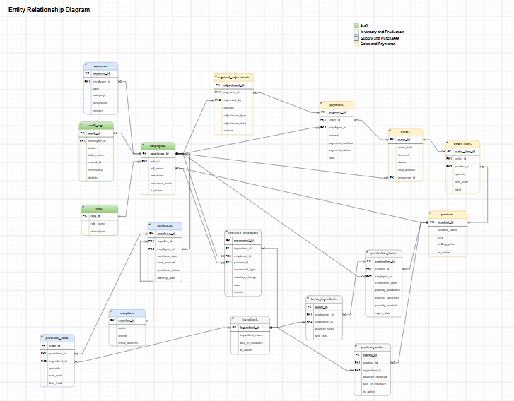
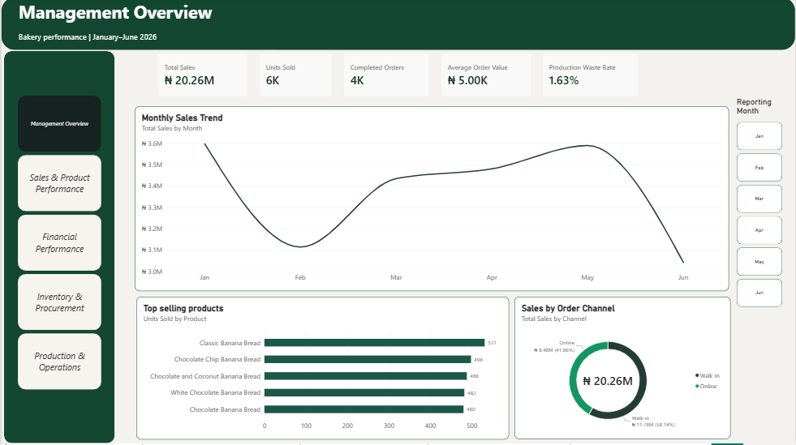
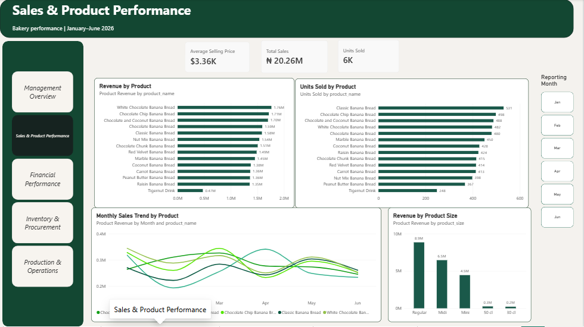
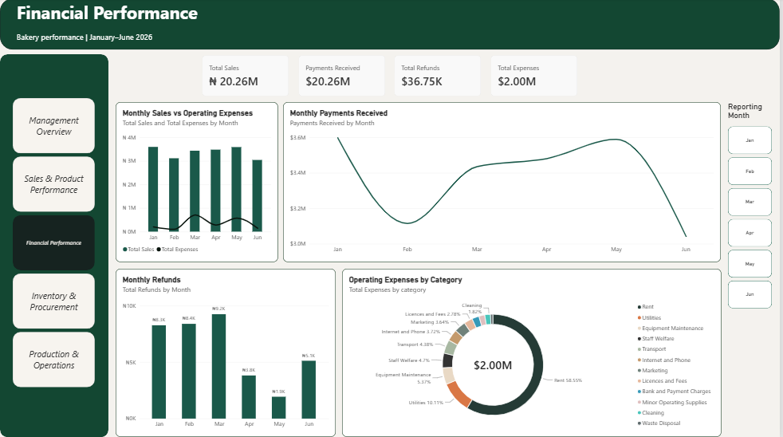
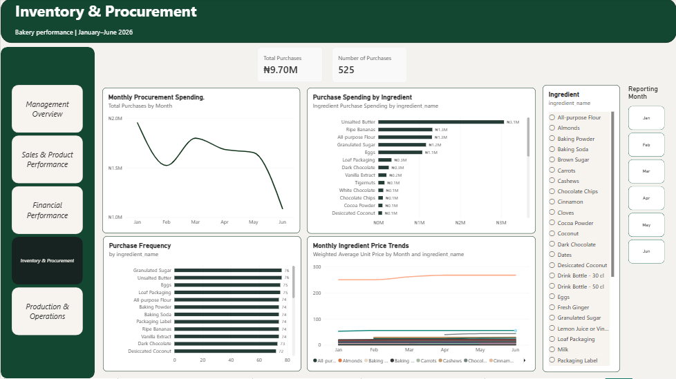
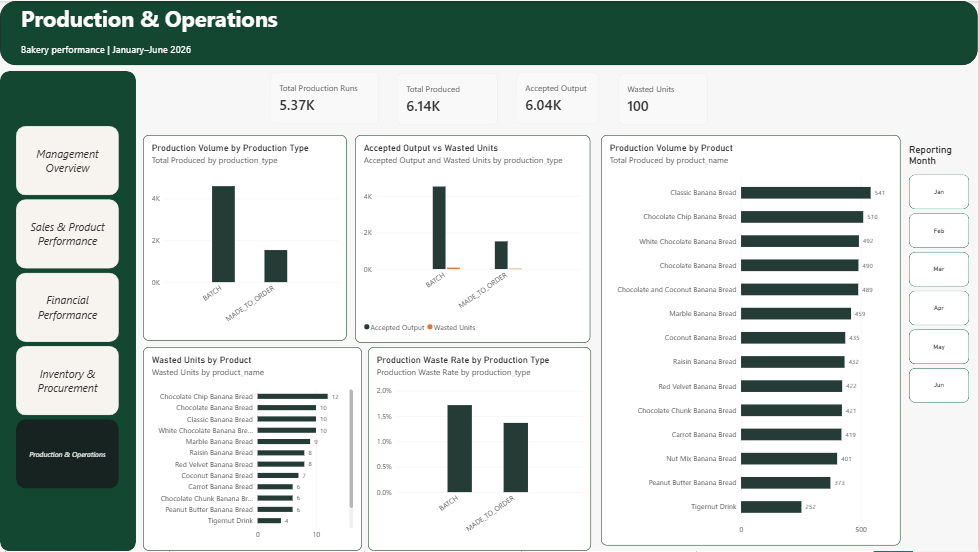

# Bakery Management & Business Performance Analysis

## Project Overview

This project demonstrates the design and development of a relational database management system and business intelligence solution for a hypothetical bakery transitioning from an online-only business model to a combination of online and walk-in sales.

The project covers the full data workflow, from requirements analysis and database development to Python-based data loading, SQL business analysis, and interactive Power BI reporting.

The database contains operational records covering sales, products, production, inventory, procurement, payments, expenses, employees, and audit activities.

**Reporting Period:** January 1 – June 30, 2026

**Data Privacy Notice:** All datasets used in this project are synthetically generated for demonstration and portfolio purposes. They do not represent actual business transactions or confidential business records.

---

## Business Problem

The bakery required a structured system for managing its operations as it expanded beyond online sales to include walk-in transactions.

The project addresses the need for:

- Centralised storage of operational and transactional records.
- Structured management of products, orders, payments, and production.
- Ingredient inventory and procurement tracking.
- Employee roles and operational record traceability.
- Business performance reporting to support management decisions.

## Project Objectives

- Design and implement a relational database using Microsoft SQL Server.
- Develop a structured data-loading process using Python.
- Implement initial and incremental data loading.
- Validate database records and relationships.
- Perform SQL-based analysis of business operations.
- Develop an interactive Power BI dashboard for business reporting.

---

## Tools & Technologies

| Tool | Application |
|---|---|
| Microsoft SQL Server | Relational database development and data storage |
| SQL / T-SQL | Database creation, validation, feature engineering and business analysis |
| Python | Synthetic data generation, initial and incremental data loading, and database utilities |
| Pandas | CSV data preparation and processing |
| PyODBC | Python-to-SQL Server connectivity |
| Power BI | Data modelling, visualisation and interactive reporting |
| Draw.io | Entity Relationship Diagram design |
| Git & GitHub | Version control and project documentation |

---

## Project Workflow

1. **Requirements Analysis:** Identified the operational and reporting requirements of the bakery.
2. **Database Design:** Developed a relational database structure and Entity Relationship Diagram.
3. **Database Development:** Created the SQL Server database and implemented its tables, constraints and relationships.
4. **Synthetic Data Generation:** Generated sample operational datasets covering the six-month reporting period.
5. **Initial Data Loading:** Used Python to import CSV datasets into SQL Server.
6. **Incremental Data Loading:** Developed a separate Python process to identify existing records and insert new records without duplicating existing data.
7. **Data Validation:** Performed structural and record-level checks to assess data consistency and integrity.
8. **SQL Business Analysis:** Used SQL queries to investigate sales, product performance, inventory, procurement, production and operational efficiency.
9. **Power BI Reporting:** Developed an interactive dashboard to present business performance indicators and findings.

---

## Database Design

The project database, `bakery_management`, was developed using Microsoft SQL Server and contains 17 relational tables.

### Entity Relationship Diagram

The diagram illustrates the database structure, primary and foreign keys, and relationships between the tables.



*Figure 1: Entity Relationship Diagram showing the 17-table relational database design.*

See [Database Design Documentation](documentation/data_model/database_design.md) for further details.

### Database Tables

| Table | Description |
|---|---|
| products | Product details and classifications |
| orders | Online and walk-in order records |
| order_items | Individual products associated with orders |
| payments | Payment transaction records |
| payment_adjustments | Payment corrections and adjustments |
| ingredients | Ingredient information |
| recipes | Ingredient requirements for products |
| production_batches | Production batch records |
| batch_ingredients | Ingredients used in production batches |
| inventory_movements | Inventory additions and deductions |
| purchases | Procurement transaction records |
| purchase_items | Individual items associated with purchases |
| suppliers | Supplier information |
| expenses | Business operating expenses |
| employees | Employee records |
| roles | Employee roles and access categories |
| audit_logs | Records of tracked operational activities |

---

## Python Data Loading and Database Utilities

Python was used to automate the movement of CSV datasets into SQL Server and support database inspection and validation.

### 1. Initial Data Loading

Developed `initial_load.py` using Pandas and PyODBC to:

- Connect to the SQL Server database.
- Retrieve database metadata, including table structures and column properties.
- Validate required columns and confirm that the expected tables exist.
- Determine a safe loading sequence using foreign-key dependencies.
- Import CSV records while preserving existing identity values using `IDENTITY_INSERT`.
- Prevent accidental duplicate imports by checking that target tables are empty before loading.

### 2. Incremental Data Loading

Developed `incremental_load.py` to support insert-only incremental loading.

The process:

- Retrieves table metadata, unique keys and foreign-key relationships.
- Determines the appropriate loading order.
- Identifies existing records using unique-key comparisons or full-row comparisons where unique keys are unavailable.
- Skips records that already exist in the database.
- Inserts new records without updating or deleting existing records.
- Uses transaction handling and rollback to protect against failed loading operations.

The process was tested by rerunning the loader against existing records, confirming that duplicate records were skipped.

### 3. Supporting Utilities

Additional scripts were developed for:

- `test_connection.py` – Testing connectivity to SQL Server.
- `inspect_database.py` – Inspecting database tables, columns and data types.
- `check_csv_columns.py` – Comparing CSV column names with SQL Server table columns.

The Python scripts are available in the [Python directory](python/).

---

## SQL Business Analysis

SQL queries were developed to investigate different areas of bakery operations.

### 1. Sales and Revenue Performance

- Analysed completed orders and total order value.
- Examined sales volume and average order value.
- Investigated monthly sales and revenue trends.

### 2. Product Performance and Profitability

- Compared product sales volumes.
- Identified top-performing products.
- Examined product-level revenue and estimated ingredient costs.

### 3. Inventory and Procurement Analysis

- Analysed ingredient consumption and inventory movements.
- Examined procurement frequency, quantities and spending.
- Investigated changes in ingredient purchase prices over the reporting period.

### 4. Production and Fulfilment Efficiency

- Compared batch production and made-to-order production.
- Examined production output, accepted quantities and waste.
- Analysed production efficiency across products.

See [SQL Analysis Documentation](documentation/analysis/sql_analysis.md) and the individual scripts in [database/sql](database/sql/).

---

## Power BI Dashboard

An interactive Power BI dashboard was developed to present operational and financial performance across five report pages.

### 1. Management Overview

Provides a high-level summary of bakery performance, including key business indicators.



*Figure 2: Management Overview – summary of key business performance indicators.*

### 2. Sales & Product Performance

Examines sales trends, order activity and product performance.



*Figure 3: Sales & Product Performance – analysis of sales activity and product contributions.*

### 3. Financial Performance

Presents financial indicators, including revenue, expenses and related performance measures.



*Figure 4: Financial Performance – overview of the bakery's financial position.*

### 4. Inventory & Procurement

Provides insights into ingredient inventory, consumption, procurement activity and purchasing costs.



*Figure 5: Inventory & Procurement – analysis of inventory movements and purchasing activity.*

### 5. Production & Operations

Examines production output, production methods, accepted quantities and waste.



*Figure 6: Production & Operations – overview of production activity and efficiency.*

The Power BI report file is available in the [Power BI directory](powerbi/).

---

## Key Business Findings

The analysis produced the following findings from the synthetic datasets:

| Metric | Finding |
|---|---:|
| Completed orders | 4,055 |
| Completed order value | ₦20,259,700 |
| Units sold | 6,036 |
| Average order value | ₦4,996.22 |
| Number of products | 14 |
| Highest-selling product by quantity | Classic Banana Bread – 531 units |
| Highest ingredient procurement expenditure | Butter – ₦3,069,391.36 |
| Highest observed ingredient price increase | Tigernuts – 14.9% |
| Total production runs | 5,372 |
| Overall production waste rate | 1.63% |

*Note: Completed order value represents the value of completed orders and should not be interpreted as cash received. Production and sales figures are aggregate measures and do not establish that all accepted production was sold.*

---

## Data and Project Limitations

- All datasets are synthetic and intended for demonstration.
- The analysis covers January to June 2026.
- The project does not include a customer table.
- No minimum inventory thresholds were defined, so stockout risk was not assessed.
- Production and sales aggregates are not necessarily aligned by transaction date.
- Estimated product profitability does not represent complete business profit because not all overhead, labour and other costs are necessarily included.
- Fulfilment duration could not be measured because the necessary completion and delivery timestamps were unavailable.

---

## Repository Structure

```text
bakery-management-analysis/
│
├── README.md
│
├── database/
│   ├── schema/
│   │   ├── 01_database_schema.sql
│   │   └── 02_feature_engineering.sql
│   │
│   ├── sql/
│   │   ├── sales_and_revenue_performance.sql
│   │   ├── product_performance_and_profitability.sql
│   │   ├── inventory_and_procurement_analysis.sql
│   │   └── production_and_fulfilment_efficiency.sql
│   │
│   └── validation/
│       ├── data_validation.sql
│       └── database_tests.sql
│
├── python/
│   ├── data_loading/
│   │   ├── initial_load.py
│   │   └── incremental_load.py
│   │
│   ├── utilities/
│   │   ├── test_connection.py
│   │   ├── inspect_database.py
│   │   └── check_csv_columns.py
│   │
│   └── requirements.txt
│
├── data/
│   ├── dataset/
│   │   └── [17 CSV datasets]
│   └── README.md
│
├── powerbi/
│   ├── bakery_management_dashboard.pbix
│   └── screenshots/
│       ├── management_overview.png
│       ├── sales_product_performance.png
│       ├── financial_performance.png
│       ├── inventory_procurement.png
│       └── production_operations.png
│
└── documentation/
    ├── data_model/
    │   ├── entity_relationship_diagram.png
    │   └── database_design.md
    │
    └── analysis/
        └── sql_analysis.md
```

---

## Conclusion

This project demonstrates an end-to-end approach to building a relational database and business intelligence solution, combining database design, Python-based data integration, SQL analysis and Power BI reporting.

It showcases practical experience in structuring operational data, automating data-loading processes, validating records, analysing business performance and presenting findings through interactive reports.