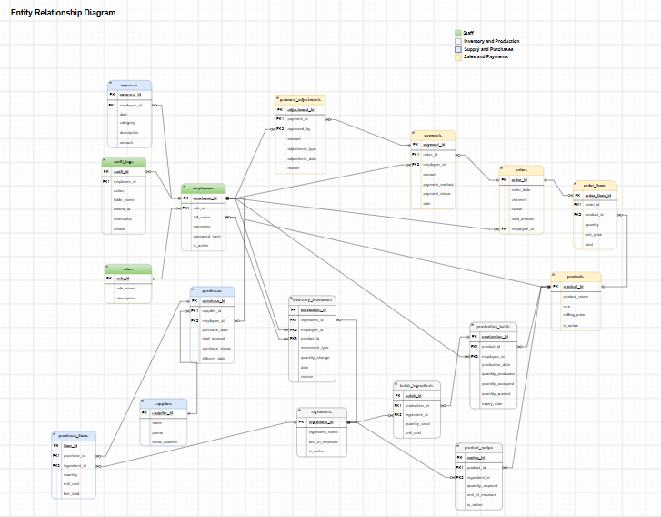

# Database Design Documentation

## 1. Database Overview

The `bakery_management` database is a relational database developed using Microsoft SQL Server to manage and represent the core operations of a bakery business.

The database consists of 17 interconnected tables designed to support sales, payments, production, inventory management, procurement, expenses, employee management and operational traceability.

## 2. Entity Relationship Diagram

The Entity Relationship Diagram (ERD) illustrates the database structure, including its entities, attributes, primary keys and foreign key relationships.

## 3. Database Entities

| Entity | Description |
|---|---|
| products | Stores information about the bakery's products. |
| orders | Records customer orders across online and walk-in channels. |
| order_items | Stores the individual products and quantities associated with each order. |
| payments | Records payments associated with orders. |
| payment_adjustments | Tracks payment adjustments, including refunds. |
| ingredients | Stores information about ingredients used in production. |
| recipes | Defines the ingredients required to produce bakery products. |
| production_batches | Records batch and made-to-order production activities. |
| batch_ingredients | Records ingredient quantities used in production batches. |
| inventory_movements | Tracks changes in ingredient and product inventory. |
| purchases | Records procurement transactions. |
| purchase_items | Stores the individual ingredients and quantities included in purchases. |
| suppliers | Stores supplier information. |
| expenses | Records the bakery's operating expenses. |
| employees | Stores employee records. |
| roles | Defines employee roles and associated responsibilities. |
| audit_logs | Maintains records of relevant system activities for traceability. |

## 4. Database Relationships

The database uses primary and foreign key relationships to maintain referential integrity and connect related business transactions.

The relationships are illustrated in the Entity Relationship Diagram above.

## 5. Design Considerations

- Relational database structure to organise business data and minimise unnecessary duplication.
- Primary and foreign keys to establish relationships between entities.
- Appropriate data types and constraints to maintain data consistency.
- Inventory movements to maintain a record of stock changes.
- Audit logs to support operational traceability.
- Separate transaction and reference tables to organise business processes.