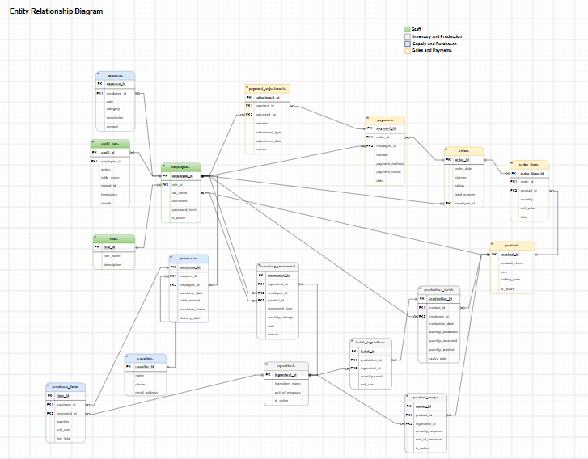
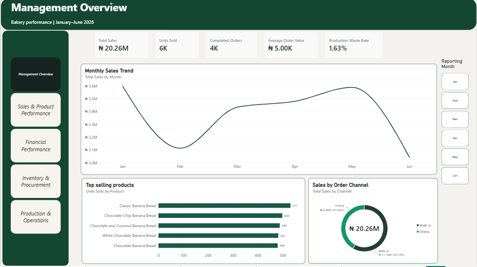
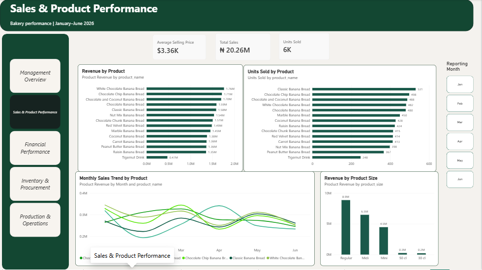
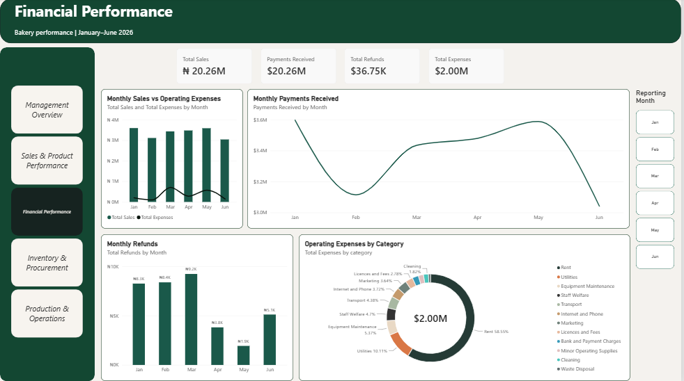
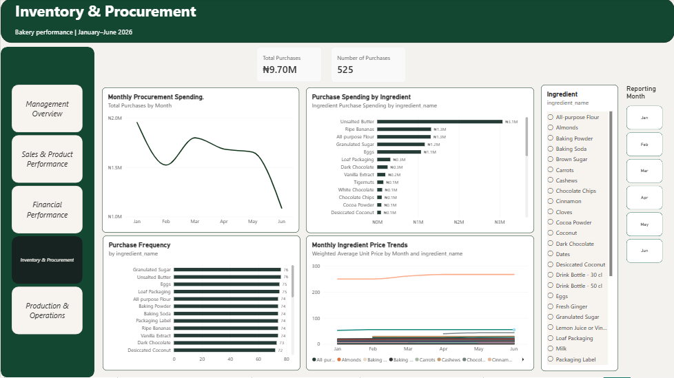
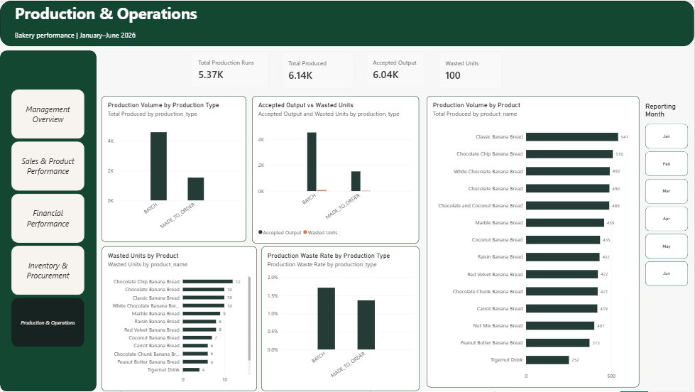

# Project Methodology and Implementation

## 1. Project Overview

This project was developed as an end-to-end data management and business intelligence solution for a hypothetical bakery transitioning from an online-only business model to a combination of online and walk-in sales.

The project explores how a relational database and analytical tools can support the management of bakery operations, including sales, production, inventory, procurement, expenses, employee access and operational record-keeping.

The implementation covers business requirements analysis, relational database design, SQL Server development, synthetic dataset preparation, Python-based data integration, data validation, SQL business analysis and Power BI reporting.

### Project Objectives

The main objectives were to:

- Design and implement a relational database for managing bakery operations.
- Organise operational records into related tables while maintaining data integrity.
- Develop Python scripts to load and integrate CSV datasets into SQL Server.
- Implement data validation and database testing procedures.
- Use SQL to investigate business performance across sales, products, inventory, procurement and production.
- Develop an interactive Power BI dashboard to communicate analytical findings.

### Project Technology Stack

| Technology | Purpose |
|---|---|
| Microsoft SQL Server | Relational database development and management |
| T-SQL | Database implementation, validation and business analysis |
| Python | Data loading and supporting utilities |
| Pandas | CSV data handling |
| PyODBC | Python-to-SQL Server connectivity |
| Power BI | Data modelling and interactive reporting |
| Draw.io | Entity Relationship Diagram development |
| Git and GitHub | Version control and project documentation |

---

## 2. Requirements Analysis

The database design was guided by the operational requirements of the hypothetical bakery.

The business scenario required a system capable of supporting both online and walk-in orders, recording production activities, monitoring ingredient movements, tracking purchases and expenses, and maintaining employee-related operational records.

The requirements also considered the need for different employee roles and access levels, alongside audit records for tracking selected operational activities.

These requirements informed the identification of database entities, their attributes and the relationships required to represent the bakery's operations.

### Identified Operational Requirements

The main operational areas considered during the design process included:

- **Sales management:** Recording online and walk-in orders, order items, payments and payment adjustments.
- **Product management:** Maintaining product information, ingredients and recipe requirements.
- **Production management:** Recording production batches, production methods and ingredient usage.
- **Inventory management:** Tracking ingredient movements and stock additions or deductions.
- **Procurement management:** Recording suppliers, purchases and purchased items.
- **Expense management:** Maintaining records of business operating expenses.
- **Employee management:** Organising employee records and assigning roles.
- **Operational traceability:** Maintaining audit records of selected activities.

These requirements formed the basis for the database structure and subsequent analytical work.

---

## 3. Database Design

Microsoft SQL Server was selected as the relational database management system.

The database, named `bakery_management`, was designed around 17 tables representing the main operational areas of the business.

### 3.1 Database Structure

The tables were organised into the following functional areas:

| Functional Area | Tables |
|---|---|
| Sales and orders | `orders`, `order_items`, `payments`, `payment_adjustments` |
| Products and recipes | `products`, `ingredients`, `recipes` |
| Production | `production_batches`, `batch_ingredients` |
| Inventory and procurement | `inventory_movements`, `purchases`, `purchase_items`, `suppliers` |
| Business operations | `expenses` |
| Employee management and access | `employees`, `roles` |
| Operational traceability | `audit_logs` |

Primary keys and foreign keys were used to establish relationships between related records and maintain referential integrity.

An Entity Relationship Diagram (ERD) was developed in Draw.io to represent the database structure and relationships between the tables.

### 3.2 Entity Relationship Diagram



*Figure 1: Entity Relationship Diagram illustrating the 17 database tables and their relationships.*

The detailed database structure, relationships and design considerations are documented separately in [Database Design](data_model/database_design.md).

---

## 4. Database Implementation

The database schema was implemented in SQL Server using Data Definition Language (DDL).

The implementation involved:

- Creating the database tables.
- Defining columns and appropriate data types.
- Establishing primary and foreign key constraints.
- Applying relevant default values and other constraints.
- Defining identity columns for automatically generated identifiers.

A separate feature engineering script was also developed to introduce additional readable identifiers, including product codes, ingredient codes, order codes, batch codes and purchase codes.

These identifiers provide more meaningful references for operational records and reporting.

### 4.1 Database Implementation Evidence


*Figure 2: Database implementation in SQL Server, showing the created database and its operational tables.*

---

## 5. Dataset Preparation

Since the project represents a hypothetical business, synthetic datasets were used instead of actual bakery transaction records.

The datasets represent six months of hypothetical bakery operations, covering the period from January 1 to June 30, 2026.

CSV files were prepared for the 17 database tables, with records structured to correspond to the database schema and relationships.

The datasets provide the source records used for database loading, validation, SQL analysis and Power BI reporting.

### 5.1 Dataset Organisation

The CSV files are organised within the repository's `data/dataset/` directory.

The datasets cover:

- Product and ingredient records.
- Employee and role information.
- Supplier and procurement records.
- Orders, order items and payment transactions.
- Production batches and ingredient usage.
- Inventory movements and expenses.
- Audit records.

### 5.2 Dataset Evidence


*Figure 3: Sample synthetic dataset prepared for integration into the SQL Server database.*

The CSV files and their descriptions are available in the [`data/dataset`](../data/dataset/) directory. Additional information about the datasets is provided in the [Dataset Documentation](../data/README.md).

---

## 6. Data Integration and Loading

Python was used to automate the transfer of CSV records into SQL Server.

The loading process was implemented using Pandas for reading and handling CSV data and PyODBC for connecting to SQL Server and executing database operations.

Two loading scripts were developed to support different loading scenarios.

### 6.1 Initial Data Loading

The initial loading script was designed to populate an empty database.

Before loading records, the script retrieves database metadata to inspect table structures, column properties, identity columns and foreign key dependencies.

It also checks that the required tables exist and that the target tables are empty before proceeding.

Tables are loaded in dependency order to ensure that referenced records are inserted before dependent records.

Where CSV files contain explicit identity values, `IDENTITY_INSERT` is used to preserve the supplied identifiers.

The script uses batch execution to insert records and commits successful table loads. Errors trigger rollback handling for the affected operation.

### 6.2 Incremental Data Loading

A separate incremental loading script was developed to support subsequent imports without repeatedly inserting existing records.

The script compares incoming records against existing database records using available unique keys. Where suitable unique keys are unavailable, it uses a full-row comparison approach, excluding identity columns where appropriate.

Records already present in the database are skipped, while new records are inserted.

The incremental process is insert-only: it does not update or delete existing records.

This approach allows additional CSV records to be introduced without requiring the database to be emptied and reloaded.

### 6.3 Supporting Python Utilities

Additional Python utilities were developed to support the loading workflow:

| Script | Purpose |
|---|---|
| `test_connection.py` | Checks connectivity to the SQL Server database. |
| `inspect_database.py` | Retrieves and displays database table and column information. |
| `check_csv_columns.py` | Compares CSV column names against corresponding database table structures. |


## 7. Data Validation and Database Testing

SQL scripts were developed to examine the loaded data and test important database conditions.

The validation process was intended to identify inconsistencies that could affect subsequent analysis.

The scripts cover checks on loaded records and database structure, including relevant data consistency and integrity conditions.

Separate scripts were organised for data validation and database testing.

### Validation Evidence


*Figure 6: SQL validation checks performed on the populated bakery management database.*

The validation and testing scripts are available in [`database/validation`](../database/validation/).


## 8. SQL-Based Business Analysis

After the database was populated and validated, SQL Server was used to investigate the bakery's operational and financial performance.

The analysis was organised into four main areas.

### 8.1 Sales and Revenue Performance

This analysis examined sales activity and revenue patterns, including:

- Order volumes.
- Completed order values.
- Average order value.
- Monthly sales and revenue performance.

### 8.2 Product Performance and Profitability

This analysis examined product sales, quantities sold and product-level performance.

Where cost information was available, product costs and estimated profitability were also investigated, with consideration given to the limitations of the available cost records.

### 8.3 Inventory and Procurement Analysis

This analysis examined:

- Ingredient usage.
- Inventory movements.
- Purchasing activity.
- Procurement expenditure.
- Changes in ingredient purchase prices over the reporting period.

### 8.4 Production and Fulfilment Efficiency

This analysis examined production activity across batch and made-to-order operations.

It included:

- Production quantities.
- Accepted output.
- Recorded production waste.
- Product-level waste rates.

### 8.5 SQL Analysis Evidence

**Screenshot 7 — SQL Business Analysis Query and Results**

Insert a representative screenshot showing one of your business analysis queries alongside its result set.

Suggested filename:

`documentation/screenshots/sql_analysis_example.png`

*Figure 7: Example of a SQL business analysis query and its resulting output.*

The SQL scripts and detailed analytical findings are available in [`database/sql`](../database/sql/) and [SQL Analysis Documentation](analysis/sql_analysis.md).

---

## 9. Power BI Development

Microsoft Power BI was used to develop an interactive dashboard for presenting the results of the SQL-based analysis.

The report was organised into five pages, each addressing a different aspect of the bakery's performance.

### 9.1 Management Overview

This page provides a summary of key business performance indicators, allowing management to view the overall performance of the bakery.

**Screenshot 8 — Management Overview**

Insert `management_overview.png` here.



*Figure 8: Management Overview dashboard page.*

### 9.2 Sales and Product Performance

This page examines order activity, revenue and product sales to provide insight into sales performance and product demand.

**Screenshot 9 — Sales and Product Performance**

Insert `sales_product_performance.png` here.



*Figure 9: Sales and Product Performance dashboard page.*

### 9.3 Financial Performance

This page presents financial metrics and relevant cost information to support the examination of the bakery's financial performance.

**Screenshot 10 — Financial Performance**

Insert `financial_performance.png` here.



*Figure 10: Financial Performance dashboard page.*

### 9.4 Inventory and Procurement

This page examines ingredient usage, purchasing activity and procurement expenditure.

**Screenshot 11 — Inventory and Procurement**

Insert `inventory_procurement.png` here.



*Figure 11: Inventory and Procurement dashboard page.*

### 9.5 Production and Operations

This page presents production activity, output and waste performance across the bakery's production operations.

**Screenshot 12 — Production and Operations**

Insert `production_operations.png` here.



*Figure 12: Production and Operations dashboard page.*

The complete Power BI report is available as [`bakery_management_dashboard.pbix`](../powerbi/bakery_management_dashboard.pbix).

---

## 10. Key Findings and Project Limitations

The analysis produced findings across sales, product performance, procurement and production.

Some of the key results include:

| Metric | Result |
|---|---:|
| Completed orders | 4,055 |
| Completed order value | ₦20,259,700 |
| Units sold | 6,036 |
| Average order value | ₦4,996.22 |
| Number of products analysed | 14 |
| Highest-selling product by units | Classic Banana Bread — 531 units |
| Highest procurement expenditure | Butter — ₦3,069,391.36 |
| Production runs | 5,372 |
| Recorded production waste | 100 units |
| Overall production waste rate | 1.63% |

These findings provide insight into the bakery's sales activity, product demand, procurement expenditure and production performance.

### 10.1 Project Limitations

The project has several limitations that should be considered when interpreting the results:

- All datasets are synthetic and do not represent actual bakery transactions.
- The analysis covers a defined six-month reporting period.
- No customer table was included in the database design.
- Minimum stock thresholds were not defined, limiting the ability to classify inventory as low or critically low.
- Aggregate production output and sales quantities cannot establish exact stock reconciliation.
- Available cost records do not account for every possible business cost, such as labour, packaging and overheads. Estimated profit measures should therefore be interpreted cautiously.
- The available order timestamps do not support a complete fulfilment-duration analysis.
- Completed order value should not automatically be interpreted as cash received, since order value and payment records represent different measures.

These limitations provide opportunities for further development, including more detailed cost tracking, stock threshold management and additional operational reporting.

---

## 11. Conclusion

The project demonstrates an end-to-end approach to developing a database-driven business intelligence solution for a hypothetical bakery.

It combines relational database design and implementation, Python-based data integration, SQL validation and business analysis, and interactive Power BI reporting.

The resulting solution provides a structured foundation for managing operational records and examining business performance while demonstrating how different data tools can work together within a practical data analytics workflow.

---

## 12. Project Repository Structure

The project files are organised into the following directories:

```text
bakery-management-analysis/
│
├── README.md
│
├── database/
│   ├── schema/
│   │   ├── 01_database_schema.sql
│   │   └── 02_feature_engineering.sql
│   │
│   ├── sql/
│   │   ├── sales_and_revenue_performance.sql
│   │   ├── product_performance_and_profitability.sql
│   │   ├── inventory_and_procurement_analysis.sql
│   │   └── production_and_fulfilment_efficiency.sql
│   │
│   └── validation/
│       ├── data_validation.sql
│       └── database_tests.sql
│
├── python/
│   ├── data_loading/
│   │   ├── initial_load.py
│   │   └── incremental_load.py
│   │
│   ├── utilities/
│   │   ├── test_connection.py
│   │   ├── inspect_database.py
│   │   └── check_csv_columns.py
│   │
│   └── requirements.txt
│
├── data/
│   ├── README.md
│   └── dataset/
│       └── [17 CSV datasets]
│
├── powerbi/
│   ├── bakery_management_dashboard.pbix
│   └── screenshots/
│       ├── management_overview.png
│       ├── sales_product_performance.png
│       ├── financial_performance.png
│       ├── inventory_procurement.png
│       └── production_operations.png
│
└── documentation/
    ├── project_methodology.md
    │
    ├── screenshots/
    │   ├── database_structure.png
    │   ├── dataset_preview.png
    │   ├── initial_data_loading.png
    │   ├── incremental_data_loading.png
    │   ├── validation_results.png
    │   └── sql_analysis_example.png
    │
    ├── data_model/
    │   ├── entity_relationship_diagram.png
    │   └── database_design.md
    │
    └── analysis/
        └── sql_analysis.md
```

